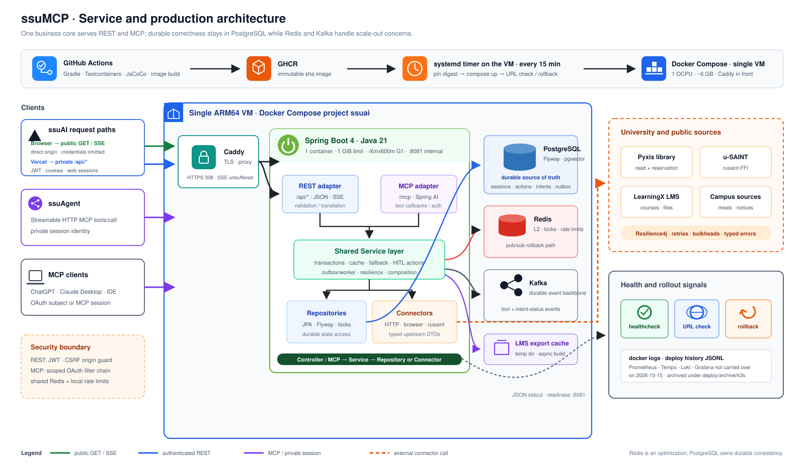

# ssuMCP

[](https://github.com/ghdtjdwn/ssuMCP/actions/workflows/ci.yml)
[](https://github.com/ghdtjdwn/ssuMCP/actions/workflows/security.yml)
[](https://github.com/ghdtjdwn/ssuMCP/actions/workflows/codeql.yml)

[한국어](README.md) · **English**

A Spring Boot backend that exposes public and authenticated Soongsil University data through
52 MCP tools and REST APIs. It owns the boundaries around university-system integrations,
per-user authentication state, action-specific consent, failure isolation, and production telemetry.
It is an unofficial project, not a university service.

[MCP endpoint](https://ssumcp.duckdns.org/mcp) ·
[Live web app](https://ssuai.vercel.app) ·
[Documentation map](docs/README.md)

## Role in the platform

| Service | Responsibility | Repository |
| --- | --- | --- |
| ssuAI | User interface, same-origin BFF, and SSE chat UX | [ghdtjdwn/ssuAI](https://github.com/ghdtjdwn/ssuAI) |
| ssuAgent | LangGraph routing, conversation state, and HITL orchestration | [ghdtjdwn/ssuAgent](https://github.com/ghdtjdwn/ssuAgent) |
| **ssuMCP** | **Campus domain logic, MCP/REST contracts, authentication, and state changes** | This repository |
| ssu-ai-service | Isolated Gemini embedding gateway (not called by ssuMCP's current request path) | [ghdtjdwn/ssu-ai-service](https://github.com/ghdtjdwn/ssu-ai-service) |

`ssuMCP` owns atomic domain tools and direct university-system integration. `ssuAgent` interprets
natural-language intent and composes tools, while `ssuAI` owns the UI and browser-session boundary.

## Connect

Register the endpoint in any client that supports remote MCP over Streamable HTTP.

```json
{
  "mcpServers": {
    "ssuMCP": {
      "url": "https://ssumcp.duckdns.org/mcp"
    }
  }
}
```

`/mcp` is POST-only, so opening it in a browser returns 400 or 404 by design. Two public endpoints
show at once that the server is up:

- [`/.well-known/mcp/server-card.json`](https://ssumcp.duckdns.org/.well-known/mcp/server-card.json) — names, input schemas, and auth notes for all 52 tools
- [`/api/meals/today`](https://ssumcp.duckdns.org/api/meals/today) — a REST read that goes through the same service layer

### Tool inventory — 21 public · 4 auth management · 27 private = 52

| Group | Tools | Examples |
| --- | --- | --- |
| Public (no login) | Cafeteria and dormitory menus, campus facilities, book search, seat catalog and per-floor seat counts, academic calendar, policy/graduation/scholarship source search, six notice tools | `get_today_meal`, `search_academic_policy_sources`, `get_library_seat_status` |
| Auth management | Per-provider login URL, session status, logout | `start_auth`, `get_auth_status`, `logout_all` |
| Private (u-SAINT · LMS · library login) | Timetable, grades, GPA simulation, graduation requirements, scholarships; LMS assignments, dashboard, material export; live seat lookup, recommendation, reservation, waiting, release | `get_my_grades`, `prepare_reserve_library_seat`, `confirm_action` |

Private tools return `AUTH_REQUIRED` with a login URL until the user signs in, and seat
reservation/release/swap and LMS export only run through the two-step `prepare_* → confirm_action`
flow. Per-tool arguments, Claude Desktop and Cursor setup, and the ChatGPT OAuth flow are in the
[MCP tools and authentication guide](docs/mcp-tools.md) (Korean).

| Authenticated graduation check | Library reservation after approval |
| --- | --- |
|  |  |

<details>
<summary>LMS export session</summary>

Personal values and active seat identifiers are de-identified in the public images. These captures
show successful sessions, not a guarantee that every external university system is always available.

| LMS export prepared | ZIP downloaded through a short-lived link |
| --- | --- |
|  |  |

</details>

### Self-host

With Java 21 or newer, the npm launcher downloads the JAR from the GitHub Release and serves
`http://localhost:8080/mcp`. The default profile uses deterministic mock connectors, so use the remote
endpoint above when you need real data. The launcher has the same Redis prerequisite as the local
run below.

```bash
npx ssumcp
# Without a local Redis
SSUAI_LIBRARY_REDIS_ENABLED=false npx ssumcp
```

## Architecture



REST controllers and MCP `@Tool` adapters call the same service layer. Every external university
system sits behind a `*Connector` interface. The default profile uses deterministic mocks for
offline development, while the production profile refuses to start unless every connector resolves
to a real, rusaint, or LLM implementation. See the [architecture document](docs/architecture.md) for
the full runtime, data, and deployment boundaries.

### Core request path

```text
ssuAI REST/BFF or MCP client
  → REST Controller / MCP Tool adapter
  → shared Service layer
  → PostgreSQL · Redis/Redisson · Kafka
  → u-SAINT · LMS · library · university website connectors
```

- Public reads are anonymous; private reads require an OAuth subject or an owned MCP session.
- Seat reservations, swaps, returns, and LMS exports use `prepare_* → confirm_action`, so they do
  not execute before explicit approval. `wait_for_library_seat` treats registration itself as consent
  to an automatic reservation; `cancel_library_wait` immediately performs the explicitly requested
  wait cancellation.
- Reservation intents use PostgreSQL row locks and claim leases as the consistency boundary;
  per-seat Redisson locks reduce duplicate upstream writes.
- Cancel and swap claims and terminal outcomes commit independently from the provider fence. After
  a process loss, current-charge reconciliation converges to success, a safe retry, compensation,
  or an explicit partial failure.
- Kafka carries production intent-status fan-out. Redis provides caching, shared rate limiting,
  and leader coordination with explicit fail-open or fail-closed behavior at each boundary.

## Engineering evidence

| Problem | Implementation and verification |
| --- | --- |
| Drift between runtime tools and the static server card | [52-tool inventory/schema parity test](src/test/java/com/ssuai/domain/mcp/config/McpToolContractInventoryTests.java) · [live tool audit](docs/audits/2026-07-14-live-tool-hardening.md) |
| Cross-user session confusion or unapproved writes | [authoritative session resolution](docs/adr/0098-authoritative-mcp-session-resolution.md) · [scoped confirm contract](docs/adr/0086-confirm-action-async-and-scoped-supersede.md) |
| External API latency, 429s, and concurrent reservations | [failure scenarios](docs/failure-scenarios.md) · [reservation concurrency integration test](src/test/java/com/ssuai/domain/library/reservation/intent/LibraryReservationIntentConcurrencyIT.java) |
| Process loss after an upstream write | Durable action phases and current-charge reconciliation — [ADR 0099](docs/adr/0099-crash-reconciled-library-actions.md) |
| Traceable retrieval under embedding failure | Lexical + embedding RRF, source metadata, and lexical fallback — [ADR 0020](docs/adr/0020-academic-policy-hybrid-rag.md) |
| Deployment of an unverified image | Multi-arch image publication runs after the test/JaCoCo gate — [CI workflow](.github/workflows/ci.yml) · [GitOps runbook](deploy/README.md) |
| Reproducing and preventing operational failures | [Troubleshooting highlights](docs/troubleshooting-highlights.md) · [load experiment](docs/performance/library-agent-load-test.md) |

The main stack is Java 21, Spring Boot 4.1, Spring AI, PostgreSQL, Redis/Redisson, Kafka,
Resilience4j, Testcontainers, Helm, ArgoCD, Prometheus, and Loki. The u-SAINT connector calls the
Rust library rusaint through a uniffi-generated Kotlin binding. The Tempo tracing chart is kept
under `deploy/` but has been scaled to zero since 2026-09 under the
[ADR 0078](docs/adr/0078-capacity-plan-2ocpu-12gb.md) capacity plan.

## Local development and verification

The default profile uses mock connectors, so no university account or external network is required.
Seat-event fan-out and scheduler locks do use Redis, so with default settings the server expects a
Redis at `localhost:6379`.

```bash
git clone https://github.com/ghdtjdwn/ssuMCP.git
cd ssuMCP

# (a) Start the same Redis 8 line the production chart uses, then run
docker run -d --name ssumcp-redis -p 6379:6379 redis:8-alpine
./gradlew bootRun

# (b) Quick look without Redis — seat SSE fan-out and distributed locks fall back to in-process/noop
SSUAI_LIBRARY_REDIS_ENABLED=false ./gradlew bootRun
```

After startup:

```text
http://localhost:8080/actuator/health      {"status":"UP"}
http://localhost:8080/swagger-ui/index.html REST documentation
http://localhost:8080/mcp                   MCP Streamable HTTP (POST only)
```

With Docker available, the suite also runs Testcontainers integration tests against PostgreSQL and
Redis. A locally skipped container test is not reported as a pass; GitHub Actions with Docker is the
authoritative gate.

```bash
./gradlew test
./gradlew test jacocoTestReport jacocoTestCoverageVerification
./gradlew build
```

See [`.env.example`](.env.example) and the [deployment runbook](deploy/README.md) for real connectors
and operations. Production Actuator endpoints are available only through the internal management
service port. Never commit real credentials. Contribution steps are in
[CONTRIBUTING](.github/CONTRIBUTING.md) (Korean).

## Documentation

- [Documentation map](docs/README.md)
- [MCP tools and authentication contract](docs/mcp-tools.md) (Korean)
- [Security, sessions, and write consistency](docs/security-consistency.md) (Korean)
- [Architecture decision records](docs/adr/) (Korean)
- [Operational troubleshooting highlights](docs/troubleshooting-highlights.md) (Korean)

## Scope and limitations

- This is an unofficial project. Changes to university pages or private APIs may temporarily break
  a connector.
- Private tools require a valid university account and authentication for the relevant provider.
  Provider session tokens are stored AES-GCM encrypted and never surface in tool responses or logs.
- The public endpoint is project infrastructure on a single-node k3s cluster and provides no
  commercial SLA. MCP request rate and concurrent requests are capped per IP.

## License

[MIT](LICENSE)
