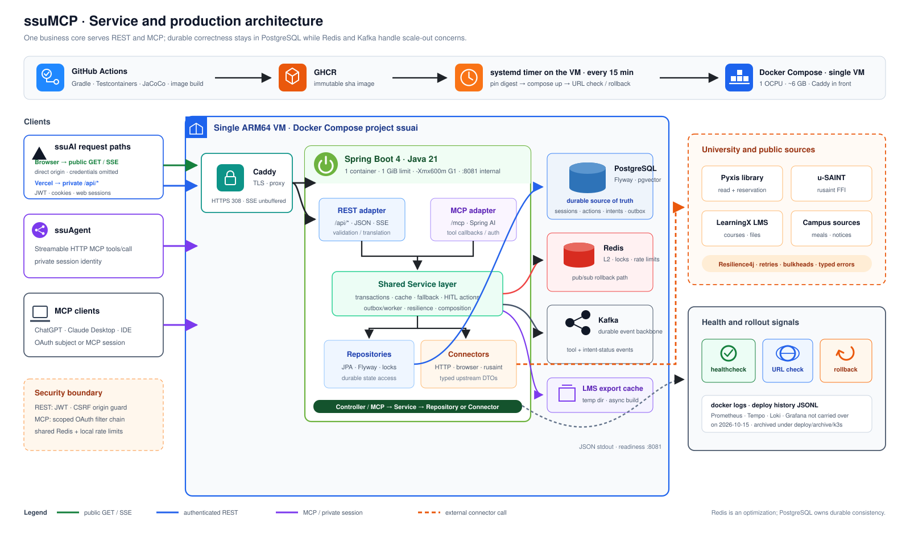

# ssuMCP

[](https://github.com/ghdtjdwn/ssuMCP/actions/workflows/ci.yml)
[](https://github.com/ghdtjdwn/ssuMCP/actions/workflows/security.yml)
[](https://github.com/ghdtjdwn/ssuMCP/actions/workflows/codeql.yml)

**한국어** · [English](README.en.md)

숭실대학교의 공개·개인 데이터를 52개 MCP 도구와 REST API로 제공하는 Spring Boot 백엔드다.
학교 시스템 연동, 사용자별 인증 상태, 작업별 동의 계약, 장애 격리와 운영 관측을 한 서비스
경계 안에서 다룬다. 학교 공식 서비스가 아닌 비공식 프로젝트다.

[MCP endpoint](https://ssumcp.duckdns.org/mcp) ·
[웹 데모](https://ssuai.vercel.app) ·
[문서 지도](docs/README.md)

## 플랫폼에서 맡는 역할

| 서비스 | 책임 | 저장소 |
| --- | --- | --- |
| ssuAI | 사용자 화면, same-origin BFF, SSE 채팅 UX | [ghdtjdwn/ssuAI](https://github.com/ghdtjdwn/ssuAI) |
| ssuAgent | LangGraph 라우팅, 대화 상태, HITL 오케스트레이션 | [ghdtjdwn/ssuAgent](https://github.com/ghdtjdwn/ssuAgent) |
| **ssuMCP** | **캠퍼스 도메인 로직, MCP/REST 계약, 인증과 상태 변경** | 현재 저장소 |
| ssu-ai-service | 격리된 Gemini 임베딩 게이트웨이 (ssuMCP의 현재 경로는 호출하지 않음) | [ghdtjdwn/ssu-ai-service](https://github.com/ghdtjdwn/ssu-ai-service) |

`ssuMCP`는 원자적인 도메인 도구와 학교 시스템 연동을 소유한다. 자연어 의도 해석과 여러 도구의
조합은 `ssuAgent`, 화면과 브라우저 세션 경계는 `ssuAI`가 맡는다.

## 연결하기

원격 MCP(Streamable HTTP)를 지원하는 클라이언트에는 다음 endpoint를 등록한다.

```json
{
  "mcpServers": {
    "ssuMCP": {
      "url": "https://ssumcp.duckdns.org/mcp"
    }
  }
}
```

`/mcp`는 POST 전용이라 브라우저로 열면 400 또는 404가 정상이다. 서버가 살아 있는지는 공개
엔드포인트로 바로 확인할 수 있다.

- [`/.well-known/mcp/server-card.json`](https://ssumcp.duckdns.org/.well-known/mcp/server-card.json) — 52개 도구의 이름·입력 스키마·인증 안내
- [`/api/meals/today`](https://ssumcp.duckdns.org/api/meals/today) — 같은 Service 계층을 쓰는 REST 공개 조회

### 도구 구성 — 공개 21 · 인증 관리 4 · 개인 27 = 52

| 구분 | 도구 | 예시 |
| --- | --- | --- |
| 공개 (인증 불필요) | 학식·기숙사 식단, 캠퍼스 시설, 도서 검색, 좌석 카탈로그·층별 좌석 집계, 학사일정, 학칙·졸업·장학 근거 검색, 공지사항 6종 | `get_today_meal`, `search_academic_policy_sources`, `get_library_seat_status` |
| 인증 관리 | provider별 로그인 URL 발급, 세션 상태 조회, 해제 | `start_auth`, `get_auth_status`, `logout_all` |
| 개인 (u-SAINT · LMS · 도서관 로그인) | 시간표·성적·GPA 시뮬레이션·졸업요건·장학금, LMS 과제·대시보드·자료 내보내기, 좌석 실시간 조회·추천·예약·대기·반납 | `get_my_grades`, `prepare_reserve_library_seat`, `confirm_action` |

개인 도구는 로그인 전에는 `AUTH_REQUIRED`와 로그인 URL을 돌려주고, 좌석 예약·반납·변경과 LMS
내보내기는 `prepare_* → confirm_action` 두 단계로만 실행된다. 도구별 인자와 Claude Desktop·Cursor
설정, ChatGPT OAuth 흐름은 [MCP 도구·인증 문서](docs/mcp-tools.md)에 있다.

| 인증된 졸업요건 조회 | 승인 후 도서관 좌석 예약 |
| --- | --- |
|  |  |

<details>
<summary>LMS 자료 내보내기 화면</summary>

개인 값과 활성 좌석 식별자는 공개용 이미지에서 비식별화했다. 화면은 한 번의 실제 연동 결과이며,
외부 학교 시스템의 모든 시점 가용성을 보장하지 않는다.

| LMS 자료 내보내기 준비 | 단기 링크로 ZIP 다운로드 |
| --- | --- |
|  |  |

</details>

### self-host

Java 21 이상이 있으면 [GitHub Release](https://github.com/ghdtjdwn/ssuMCP/releases/latest)의 JAR 하나로
`http://localhost:8080/mcp`를 띄운다. 기본 profile의 connector는 전부 결정적인 mock이므로 실데이터가
필요하면 위 원격 endpoint를 쓴다. 아래 로컬 실행과 같은 Redis 전제를 가진다.

```bash
curl -LO https://github.com/ghdtjdwn/ssuMCP/releases/download/v0.2.0/ssuMCP-0.2.0.jar
java -jar ssuMCP-0.2.0.jar
# Redis 없이 빠르게 볼 때
SSUAI_LIBRARY_REDIS_ENABLED=false java -jar ssuMCP-0.2.0.jar
```

npm 런처 [`ssumcp`](https://www.npmjs.com/package/ssumcp)는 자기 버전과 같은 Release JAR을 받아 실행하는데,
레지스트리의 latest가 아직 0.1.1이라 `npx ssumcp`는 구버전 서버(도구 23개, Redis 플래그 없음)를 띄운다.
0.2.0이 게시되기 전까지는 위 JAR 방식을 쓴다.

## 아키텍처



REST Controller와 MCP `@Tool` adapter는 같은 Service 계층을 호출한다. 외부 학교 시스템은
`*Connector` 인터페이스 뒤에 격리한다. 기본 profile은 결정적인 mock으로 오프라인 개발을 지원하지만,
production profile은 모든 connector가 real/rusaint/llm인지 검증하고 mock 또는 누락된 설정이면 기동을
거부한다. 상세 런타임·데이터·배포 경계는 [아키텍처 문서](docs/architecture.md)에 있다.

### 핵심 요청 흐름

```text
ssuAI REST/BFF 또는 MCP client
  → REST Controller / MCP Tool adapter
  → shared Service layer
  → PostgreSQL · Redis/Redisson · Kafka
  → u-SAINT · LMS · 도서관 · 학교 웹사이트 connector
```

- 공개 조회는 인증 없이 사용하고, 개인 조회는 OAuth subject 또는 소유권이 확인된 MCP 세션에만 연결한다.
- 좌석 예약·이석·반납과 LMS 내보내기는 `prepare_* → confirm_action`으로 분리해 사용자 승인 전에
  실행하지 않는다. `wait_for_library_seat`는 호출 자체가 자동 예약 동의이고, `cancel_library_wait`는
  명시적 대기 취소를 즉시 수행하는 예외다.
- 예약 intent는 PostgreSQL 행 잠금과 claim lease를 정합성 기준으로 삼고, 좌석별 Redisson lock은 중복
  upstream write를 줄이는 보조 계층으로 사용한다.
- 좌석 반납·변경의 claim과 종료 결과는 provider fence와 독립적으로 커밋한다. 프로세스가 upstream write
  중간에 종료되면 현재 예약을 다시 조회해 성공, 안전한 재실행, 원좌석 보상 또는 부분 실패로 수렴한다.
- 운영 상태 fan-out은 Kafka, 캐시·공유 rate limit·리더 선출은 Redis를 사용하며 장애 시 경로별로
  fail-open 또는 fail-closed 정책을 명시한다.

## 엔지니어링 근거

| 문제 | 구현과 검증 근거 |
| --- | --- |
| MCP 도구와 정적 server card의 계약 drift | [52-tool inventory/schema parity test](src/test/java/com/ssuai/domain/mcp/config/McpToolContractInventoryTests.java) · [live tool audit](docs/audits/2026-07-14-live-tool-hardening.md) |
| 사용자별 세션 혼선과 승인 없는 쓰기 | [authoritative session resolution](docs/adr/0098-authoritative-mcp-session-resolution.md) · [scoped confirm contract](docs/adr/0086-confirm-action-async-and-scoped-supersede.md) |
| 외부 API 지연·429·동시 예약 | [failure scenarios](docs/failure-scenarios.md) · [reservation concurrency integration test](src/test/java/com/ssuai/domain/library/reservation/intent/LibraryReservationIntentConcurrencyIT.java) |
| upstream write 뒤 프로세스 중단 | durable action phase + current-charge reconciliation — [ADR 0099](docs/adr/0099-crash-reconciled-library-actions.md) |
| 검색 근거 추적과 임베딩 장애 | lexical + embedding RRF, source metadata, lexical fallback — [ADR 0020](docs/adr/0020-academic-policy-hybrid-rag.md) |
| 검증되지 않은 이미지의 자동 배포 | test/JaCoCo gate 뒤 multi-arch image publish, 서버 타이머가 공개 주소 확인 뒤 교체·실패 시 롤백 — [CI workflow](.github/workflows/ci.yml) · [배포 runbook](deploy/README.md) |
| 운영 장애의 재현과 예방 | [troubleshooting highlights](docs/troubleshooting-highlights.md) · [부하 실험](docs/performance/library-agent-load-test.md) |

주요 스택은 Java 21, Spring Boot 4.1, Spring AI, PostgreSQL, Redis/Redisson, Kafka, Resilience4j,
Testcontainers, Docker Compose, GitHub Actions, GHCR다. u-SAINT 커넥터는 Rust 라이브러리 rusaint를 uniffi로
생성한 Kotlin 바인딩으로 호출한다. 운영 환경은 2026-10-15부터 단일 VM의 Docker Compose와 Caddy이며
([ADR 0101](docs/adr/0101-single-vm-docker-compose-timer-pull.md)), 이관 때 이전 k3s/ArgoCD/Helm 정의와
Prometheus·Loki·Tempo 모니터링 스택은 가져가지 않았다. 옛 정의는
[`deploy/archive/k3s/`](deploy/archive/k3s/README.md)에 참고용으로만 남아 있다.

## 로컬 실행과 검증

기본 profile은 mock connector를 사용하므로 실제 학교 계정이나 외부 네트워크가 필요하지 않다. 다만
좌석 이벤트 fan-out과 스케줄러 lock이 Redis를 쓰므로 기본 설정으로는 `localhost:6379`에 Redis가 있어야
기동한다.

```bash
git clone https://github.com/ghdtjdwn/ssuMCP.git
cd ssuMCP

# (a) 운영과 같은 Redis 8 라인을 띄우고 실행
docker run -d --name ssumcp-redis -p 6379:6379 redis:8-alpine
./gradlew bootRun

# (b) Redis 없이 빠르게 볼 때 — 좌석 SSE fan-out과 분산 lock이 in-process/noop으로 동작한다
SSUAI_LIBRARY_REDIS_ENABLED=false ./gradlew bootRun
```

기동 뒤 확인:

```text
http://localhost:8080/actuator/health      {"status":"UP"}
http://localhost:8080/swagger-ui/index.html REST 문서
http://localhost:8080/mcp                   MCP Streamable HTTP (POST 전용)
```

검증 명령은 다음과 같다. Docker가 있으면 Testcontainers 기반 PostgreSQL·Redis 통합 테스트도 실행된다.
로컬에서 container test가 skip된 경우 통과로 간주하지 않으며, Docker가 있는 GitHub Actions가 권위
게이트다.

```bash
./gradlew test
./gradlew test jacocoTestReport jacocoTestCoverageVerification
./gradlew build
```

실제 connector와 운영 설정은 [`.env.example`](.env.example), [배포 runbook](deploy/README.md)을
참고한다. 운영 Actuator는 컨테이너 내부 management port에서만 제공하며 공개 주소의 `/actuator/*`는
404다. 실제 자격증명은 저장소에 커밋하지 않는다. 기여 절차는 [CONTRIBUTING](.github/CONTRIBUTING.md)에 있다.

## 문서

- [문서 지도](docs/README.md)
- [MCP 도구와 인증 계약](docs/mcp-tools.md)
- [보안·세션·write consistency](docs/security-consistency.md)
- [ADR 목록](docs/adr/)
- [운영 장애 하이라이트](docs/troubleshooting-highlights.md)

## 범위와 제약

- 비공식 프로젝트다. 학교 웹페이지나 비공개 API가 바뀌면 connector가 일시적으로 동작하지 않을 수 있다.
- 개인 도구는 유효한 학교 계정과 해당 provider 인증이 필요하다. provider 세션 토큰은 AES-GCM으로
  암호화해 저장하고 도구 응답이나 로그에 노출하지 않는다.
- 공개 endpoint는 단일 VM(Docker Compose, 인스턴스 1개) 위의 프로젝트 운영 환경이며 상용 SLA를 제공하지
  않는다. 이미지 교체 중 1~2분 동안 응답하지 않을 수 있고, IP별 MCP 요청 속도와 동시 요청 수에 상한이 있다.

## 라이선스

[MIT](LICENSE)
